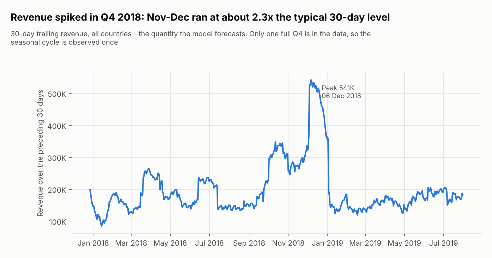
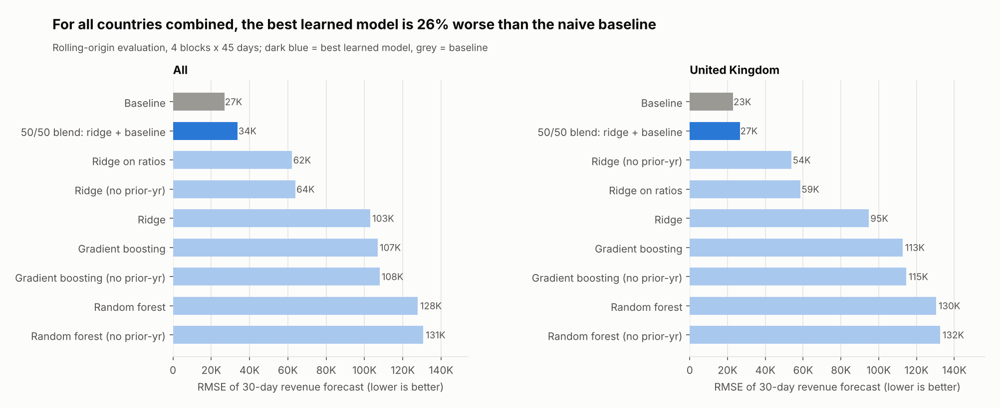
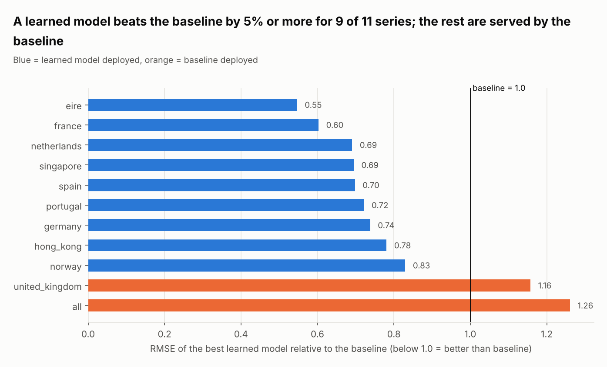
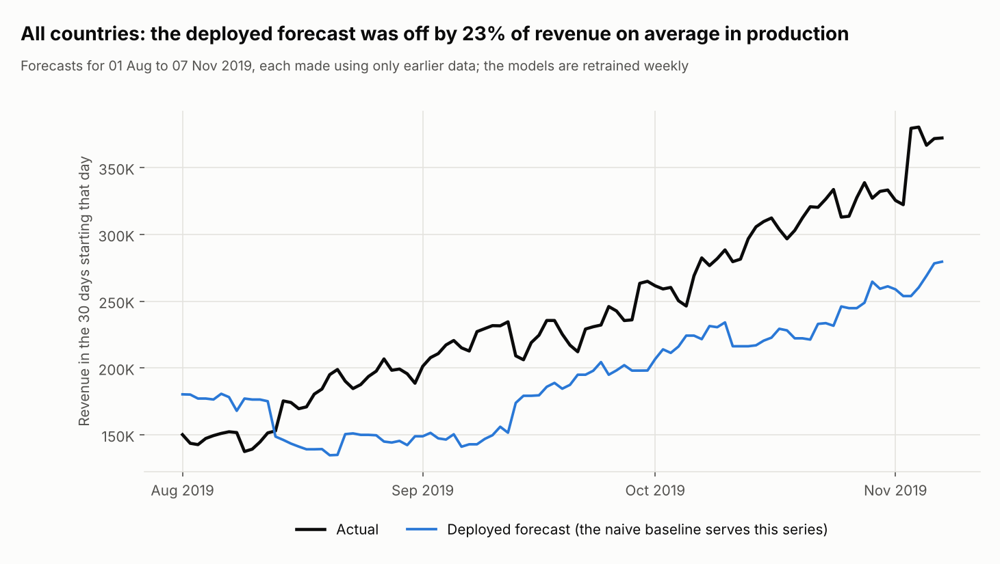
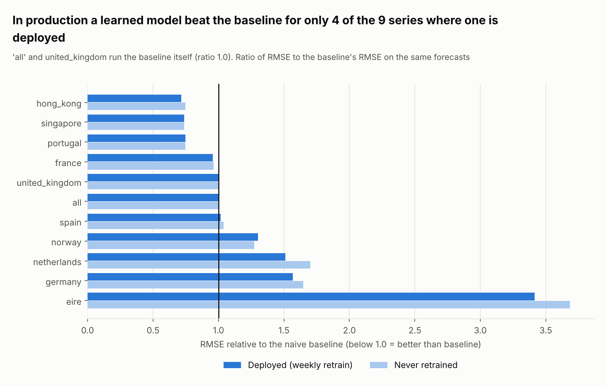
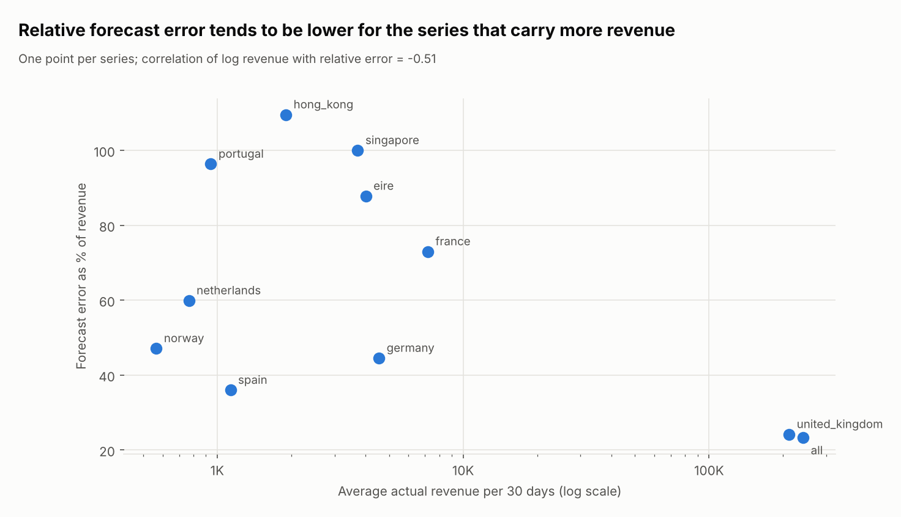

# Forecasting 30-day revenue: findings

## 1. Business opportunity and question

AAVAIL's leadership wants to forecast revenue for the next 30 days, per country and overall, to plan
spending and staffing. The deliverable is a service that answers: *"how much revenue will we make in the
30 days starting on date D?"* using only what was known before D.

Hypothesis: recent revenue is the main driver of next month's revenue, and a learned model can improve on
simply repeating it. That "repeat it" rule is the **baseline**: revenue of the last 28 days, scaled to 30.

## 2. Data and cleaning decisions

Source: monthly invoice files, 2017-11-28 to 2019-07-31 for training (815,011 rows, 43 countries), plus
2019-08-01 to 2019-12-06 as the production set that was kept untouched until the end.

* The files use four spellings for the same columns (`StreamID`, `TimesViewed`, `total_price`); some files
  mix them. They are merged into one set of columns.
* **Bad-debt adjustments** (invoice prefix `A`, three rows, one of -53,594) are excluded: they are not sales.
* **Cancellations** (prefix `C`) are kept. Their prices are positive in the source, so it is unclear whether
  they should be subtracted. This is an open question for the business (`eda_07_cancellations.png`);
  it is not silently decided.
* Days with no trading become zero-revenue days, so the series has no gaps.

## 3. Exploratory analysis

* The UK produces 90.3% of revenue and the top 10 countries 97.8%, so overall accuracy is mostly UK accuracy.
* Revenue has a strong Q4 peak (about 2.3 times a typical period) and a weekly pattern with no Saturday sales.
* Small countries are sparse: for example Norway, Hong Kong and Singapore have no sales on 97-99% of days
  (`eda_05_sparse_series.png`). Their daily series are very noisy, so 30-day totals are the sensible target.
* The data cover only **one** full year, so a model can see each season once.

More figures: `reports/figures/eda_02` to `eda_07`.

## 4. Models compared

Target: revenue of days D to D+29. Features: revenue over the previous 7, 14, 28 and 70 days, revenue a
year earlier, and recent invoices and views. Every feature uses only days before D (a unit test checks this).

Evaluation: four consecutive 45-day test blocks at the end of the training data. Each block is predicted by
models fitted only on rows whose 30-day target had finished before the block started (a 30-day gap).
Candidates: the naive baseline, ridge regression, random forest, gradient boosting (each with and without
the prior-year features), a ridge model on ratios (scale-free) and a 50/50 blend of ridge and baseline.
A learned model is deployed for a series only if it beats the baseline by at least 5%.

Result: learned models beat the baseline in **9 of 11 series** (error 17% to 45% lower). For **all
countries combined and the UK, no learned model won** (best: 26% and 16% worse), so the baseline is
deployed there. The reason is visible in the fold-by-fold results: with one seasonal cycle, absolute-level
models over-predict the quiet months after the Q4 peak. By the fourth block a ridge model without prior-year
features (22.9K) already edges out the baseline (25.2K), which suggests the learned models improve as more
history accumulates, but with this data the baseline is the honest choice for the two big series.

## 5. API, tests, monitoring and scale

* **API**: train, predict (single and batch), log files, models, monitor, health. Bad input gets a clear
  400/404/503 message; two training runs cannot overlap (409).
* **Tests**: 76 unit tests for the API, the model, logging and monitoring, run with one script
  (`python run-tests.py`). They use synthetic data and temporary directories chosen through environment
  variables (and `test` file prefixes), so they never touch production models or logs.
* **Test-driven development**: the tests for features, the model and the API were written first and the code
  was then written to satisfy them (leakage, date handling, error codes and isolation are each covered).
* **Monitoring**: every prediction is logged with its runtime, model version, whether the date lies inside
  the training window and a drift check (largest z-score of the features against the training data; flagged
  above 4). `/monitor` compares logged out-of-sample predictions with actual revenue once it is known.
* **Scale and load** (`load_test.py`, one gunicorn worker with 4 threads, models and data loaded at start-up):

  | Concurrent clients | Requests per second | Median | 95th percentile |
  |---|---|---|---|
  | 1 | 110 | 7 ms | 22 ms |
  | 8 | 63 | 114 ms | 231 ms |
  | 32 | 67 | 457 ms | 594 ms |

  A batch of 50 queries takes about 0.3 s. Throughput does not grow with concurrency because one Python
  process serves all requests; no request failed. The first request used to take 11 s while the data loaded,
  so the data and models are now loaded at start-up. One worker is deliberate (the model cache and training
  lock live in process memory); scaling out means several containers behind a load balancer, with models
  trained once and shared.
* **Drift**: 12% of the production requests were flagged. Their error was somewhat higher than for unflagged
  ones, but it is pooled over very different series, so we treat this as a weak signal, not a proof.

## 6. Production results (the gold standard: what really happened)

The production months were replayed through the API one day at a time (99 days, 11 series, 1,089 forecasts),
with the models retrained every Monday using only data from before that day (`simulate_production.py`).

| Series | Deployed model | RMSE vs baseline | Error as % of revenue | Forecasts within 20% |
|---|---|---|---|---|
| all | baseline | 1.00 | 23% | 33% |
| united_kingdom | baseline | 1.00 | 24% | 36% |
| hong_kong | random forest | 0.72 | 110% | 18% |
| singapore | ridge on ratios | 0.74 | 100% | 42% |
| portugal | blend | 0.75 | 96% | 8% |
| france | ridge | 0.96 | 73% | 16% |
| spain | blend | 1.02 | 36% | 26% |
| norway | ridge on ratios | 1.30 | 47% | 17% |
| netherlands | ridge | 1.51 | 60% | 5% |
| germany | ridge | 1.57 | 44% | 34% |
| eire | ridge | 3.42 | 88% | 10% |

(Full table: `reports/post_production_metrics.csv`.)

What this says, without spin:

1. **The big picture is a systematic under-forecast.** Revenue climbed from about 150K to about 370K per
   30 days between August and November 2019; a forecast built from the last 28 days lags that growth. For
   all countries the average bias was about -49K per 30-day forecast (about 20% too low), and only one
   forecast in three was within 20% of the truth.
2. **The learned models did not hold up in production as well as in validation.** They beat the baseline in
   4 of the 9 series where one is deployed. Eire, Germany and the Netherlands were clearly worse than the
   baseline, even though they had won in validation. Validation on one seasonal year picked models that
   fitted the past months, not the coming ones.
3. **Retraining weekly helped only slightly.** Against the same models never retrained, the retrained
   models' error was 0% to 11% lower in most series (about 2% higher in Norway, and equal for the
   baseline series). It is worth its small cost, but it does not rescue the weak models.
4. **Performance relates to the business metric through revenue size.** Relative error is lower for the series
   that carry the most revenue (correlation of log revenue with relative error -0.51 across 11 series), so the
   forecast is usable for the UK-dominated total and not for the small countries, whose 30-day revenue is
   a handful of invoices.

## 7. Recommendations

* Use the forecast for the **overall and UK** revenue as a **floor** (it under-forecast growth), not as a
  point target, until a full second year of data exists.
* Do not use per-country forecasts for Eire, Germany, the Netherlands or Norway; the baseline is better
  there. Add an automatic **baseline guard**: monitor each series' rolling error with `/monitor` and fall
  back to the baseline when a learned model is worse than the baseline over the last 60 days.
* Ask the business how cancellations should be treated; it changes revenue and therefore every forecast.
* Retrain weekly (the simulation shows it is cheap: a full retrain of all 11 models takes about a second or two) and re-run the comparison
  when the next quarter of data arrives.

## 8. Limitations

* One seasonal cycle: the models cannot learn seasonality they have only seen once.
* The production period was a growth phase heading into Q4; results may differ in a steady year.
* Selection used four test blocks; with this much noise the choices for small countries are fragile
  (confirmed by their production results).
* Data end on 2019-12-06, so the last 29 days of forecasts cannot be scored yet.
* The Docker image could not be built in the environment where this was developed (no access to Docker Hub);
  the Dockerfile's steps (install, train, run tests) were run directly instead, and the pinned requirements
  were checked to resolve for Python 3.13.
